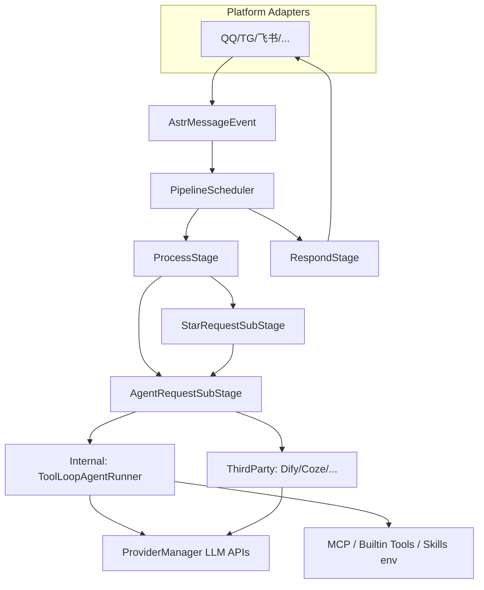

# 技术架构

## 总体定位

AstrBot 是**面向即时通讯（IM）场景的一体化 Agent 聊天机器人平台**：将多平台消息适配、对话管道（Pipeline）、大模型提供商（Provider）、插件扩展（Star）、内置 Agent 循环、知识库、MCP、Skills、Web 管理面板等组合在同一进程（及可选沙盒侧车）中运行。

## 启动与生命周期

1. `**main.py`**：环境检查、数据目录初始化、拉起 `InitialLoader`。
2. `**InitialLoader**`（`astrbot/core/initial_loader.py`）：创建 `AstrBotCoreLifecycle` 与 `AstrBotDashboard`，`asyncio.gather` 并行运行核心循环与面板服务。
3. `**AstrBotCoreLifecycle**`（`astrbot/core/core_lifecycle.py`）：初始化数据库、配置、人格、Provider、平台、对话、知识库、Cron、**插件管理器**、**管道调度器**、事件总线等；对外暴露 `Context` 供插件使用。

## 消息处理管道（Pipeline）

平台适配器将原始消息转为统一的 `AstrMessageEvent`，由 `**PipelineScheduler`**（`astrbot/core/pipeline/scheduler.py`）按注册顺序驱动多个 **Stage**。内置顺序定义在 `astrbot/core/pipeline/stage_order.py`：

| 顺序  | Stage                   | 职责（摘要）                  |
| --- | ----------------------- | ----------------------- |
| 1   | WakingCheckStage        | 是否需唤醒                   |
| 2   | WhitelistCheckStage     | 群/私聊白名单                 |
| 3   | SessionStatusCheckStage | 会话是否启用                  |
| 4   | RateLimitStage          | 频率限制                    |
| 5   | ContentSafetyCheckStage | 内容安全                    |
| 6   | PreProcessStage         | 预处理                     |
| 7   | **ProcessStage**        | **插件（Star）或 LLM/Agent** |
| 8   | ResultDecorateStage     | 结果装饰（前缀、TTS、文生图等）       |
| 9   | RespondStage            | 回发消息                    |

**ProcessStage**（`astrbot/core/pipeline/process_stage/stage.py`）是核心分叉点：

- 若事件上已有插件 Handler 激活：走 `**StarRequestSubStage`**；若 Handler 需要 LLM，则再进入 `**AgentRequestSubStage**`。
- 否则在满足唤醒、`provider_settings.enable` 等条件时，走 `**AgentRequestSubStage**` 调用模型/Agent。

Stage 支持异步生成器实现**洋葱模型**：在 `yield` 前后分别做前置/后置逻辑，并可在中途 `event.is_stopped()` 终止传播。

## Agent 执行路径

`**AgentRequestSubStage`**（`astrbot/core/pipeline/process_stage/method/agent_request.py`）根据配置 `provider_settings.agent_runner_type` 分支：

- `**local**`：`**InternalAgentSubStage**` — 使用 AstrBot 内置 Agent（见下文）。
- **非 local**：`**ThirdPartyAgentSubStage`** — 对接 Dify、Coze、阿里云百炼应用、DeerFlow 等已在文档中说明的「Agent 执行器」类 Provider。

内置 Agent 的循环实现为 `**ToolLoopAgentRunner**`（`astrbot/core/agent/runners/tool_loop_agent_runner.py`），在工程里通过类型别名暴露为 `AgentRunner`（`astrbot/core/astr_agent_run_util.py`）：负责多轮 **补全 → 工具调用 → 写回消息 → 再补全**，直到结束或达到步数上限。主 Agent 装配逻辑集中在 `**astrbot/core/astr_main_agent.py`**（工具集、Skills 提示、沙盒/本地执行、MCP、子 Agent Handoff 等）。

## 平台与提供商

- **PlatformManager** + 各 `platform/sources/*`：QQ、Telegram、飞书、企业微信、Discord、Slack 等适配。
- **ProviderManager**：OpenAI 兼容、Anthropic、Gemini 等聊天/语音及 **agent_runner** 类型提供商。

## 扩展层

- **Star（插件）**：`PluginManager` 扫描加载，`star_handler` 注册事件与指令；上下文为 `astrbot/core/star/context.py` 的 `Context`。
- **Skills**：数据目录下 `skills/`，由 `**SkillManager`**（`astrbot/core/skills/skill_manager.py`）管理安装与列表；通过 `**build_skills_prompt**` 将「技能名 + 描述」注入系统提示，配合沙盒或本地执行环境按需展开 `SKILL.md`（渐进式披露）。
- **MCP**：`mcp` 依赖与 `astrbot/core/agent/mcp_client.py` 等，将外部工具以 MCP 协议接入 Agent 工具集。

## 管理面板（Dashboard）

- 后端：**Quart** + **Hypercorn**（`astrbot/dashboard/server.py`），与核心生命周期共享配置与数据库。
- 前端：独立 `**dashboard/`** 工程（Vue 3 + Vite + Vuetify），构建产物可打入 wheel 或放在 `data/dist`。

## 数据与配置

- 配置、插件、知识库、Skills 等路径由 `**astrbot/core/utils/astrbot_path.py**`（及 `path_utils`）解析，默认落在数据目录下，便于容器挂载单卷。

## 架构示意图（逻辑）

